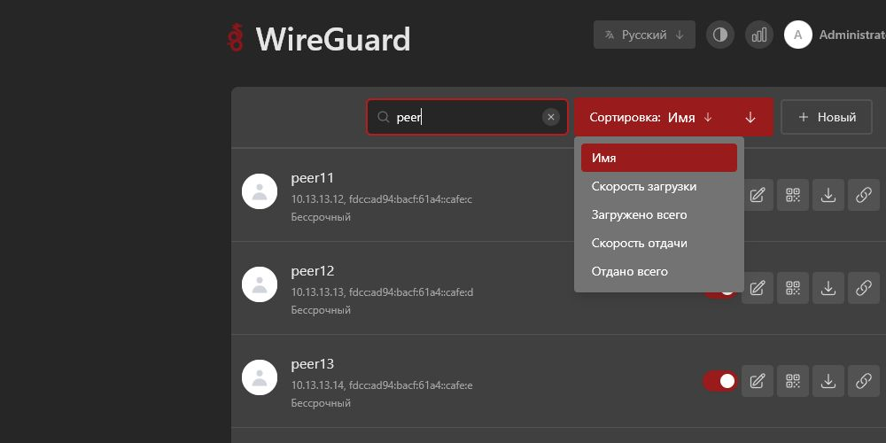
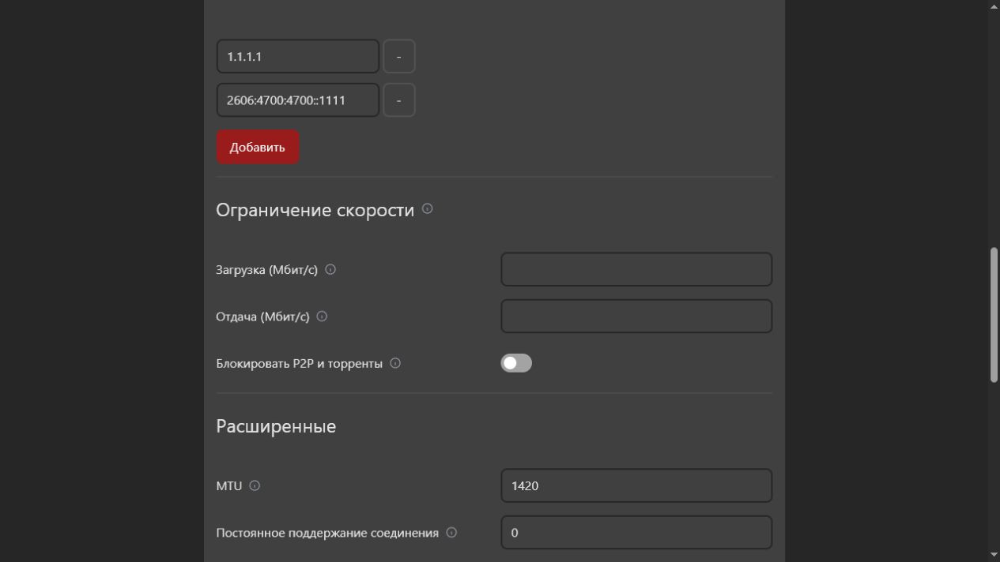

# wg-easy-enhanced

Расширенная сборка [wg-easy](https://github.com/wg-easy/wg-easy) 15.3.0 с дополнительными средствами управления клиентами WireGuard.

Актуальный образ:

```text
ghcr.io/beosav/wg-easy-enhanced:v15.3.0-p2p.1
```

## Доработки

### Сортировка клиентов

В список клиентов добавлена сортировка по:

- имени;
- текущей скорости загрузки;
- общему объёму загруженного трафика;
- текущей скорости отдачи;
- общему объёму отданного трафика.

Направление сортировки переключается отдельной кнопкой. Выбранные поле и направление сохраняются в cookie браузера на один год. При одинаковых значениях клиенты дополнительно упорядочиваются по имени.



### Ограничение скорости

В настройках каждого клиента появились отдельные лимиты:

- **Загрузка (Мбит/с)** — ограничение трафика от VPN-сервера к клиенту;
- **Отдача (Мбит/с)** — ограничение трафика от клиента к VPN-серверу.

Допустимое значение — от `1` до `10000` Мбит/с. Пустое поле или `0` снимает ограничение. Лимиты применяются средствами Linux Traffic Control (`tc`): HTB и `fq_codel` для загрузки, ingress policing для отдачи.

### Блокировка P2P и торрентов

Для каждого клиента доступен переключатель **Блокировать P2P и торренты**. После включения сервер применяет отдельные правила IPv4 и IPv6, которые блокируют:

- типовые BitTorrent-порты `6881–6999` и `51413`;
- открытый BitTorrent handshake;
- сигнатуру UDP-трекера;
- DNS-запросы к известным DHT bootstrap-узлам;
- более 100 одновременных TCP-соединений от клиента;
- чрезмерную частоту новых UDP-соединений: более 60 в секунду с burst до 120.

Правила применяются только к клиентам, у которых включён переключатель. Изменения лимитов и P2P-фильтра применяются после сохранения клиента без отдельного перезапуска WireGuard.

> [!IMPORTANT]
> Фильтрация работает по портам, открытым сигнатурам и характерным признакам соединений. Она существенно затрудняет обычный BitTorrent-трафик, но не гарантирует блокировку зашифрованного, замаскированного или переданного через другой туннель P2P-трафика. Ограничения количества соединений могут затронуть другие приложения с большим числом параллельных подключений.



## Требования

- Linux-сервер с Docker Engine и Docker Compose;
- поддержка WireGuard ядром или доступ к `/lib/modules`;
- возможности контейнера `NET_ADMIN` и `SYS_MODULE`;
- открытый UDP-порт WireGuard, обычно `51820`;
- доступ к веб-интерфейсу через HTTPS reverse proxy или SSH-туннель.

Образ уже содержит `iproute2`, `iptables`, `ip6tables` и необходимые WireGuard-инструменты.

## Новая установка

Создайте каталог:

```bash
mkdir -p /opt/wg-easy
cd /opt/wg-easy
```

Создайте `docker-compose.yml`:

```yaml
volumes:
  etc_wireguard:

services:
  wg-easy:
    image: ghcr.io/beosav/wg-easy-enhanced:v15.3.0-p2p.1
    container_name: wg-easy
    volumes:
      - etc_wireguard:/etc/wireguard
      - /lib/modules:/lib/modules:ro
    ports:
      - "51820:51820/udp"
      - "127.0.0.1:51821:51821/tcp"
    restart: unless-stopped
    cap_add:
      - NET_ADMIN
      - SYS_MODULE
    sysctls:
      - net.ipv4.ip_forward=1
      - net.ipv4.conf.all.src_valid_mark=1
      - net.ipv6.conf.all.disable_ipv6=0
      - net.ipv6.conf.all.forwarding=1
      - net.ipv6.conf.default.forwarding=1
```

Запустите панель:

```bash
docker compose pull wg-easy
docker compose up -d wg-easy
docker compose ps
```

Порт панели в примере доступен только на сервере. Откройте SSH-туннель с локального компьютера:

```bash
ssh -N -L 51822:127.0.0.1:51821 root@SERVER_IP
```

Пока команда работает, откройте в браузере:

```text
http://127.0.0.1:51822
```

Для постоянного публичного доступа используйте HTTPS reverse proxy и настройте аутентификацию. Не публикуйте административную панель в интернет по незащищённому HTTP.

## Обновление существующей установки

### 1. Найдите каталог и имя тома

```bash
cd /путь/к/каталогу-с-compose
docker compose ps
docker volume ls
```

### 2. Создайте резервную копию

Замените `VOLUME_NAME` на том, подключённый к `/etc/wireguard`:

```bash
mkdir -p backup
docker run --rm \
  -v VOLUME_NAME:/data:ro \
  -v "$PWD/backup:/backup" \
  alpine \
  tar -czf /backup/wg-easy-$(date +%Y%m%d-%H%M%S).tar.gz -C /data .
```

Убедитесь, что архив создан:

```bash
ls -lh backup/
```

### 3. Замените образ

В `docker-compose.yml`:

```yaml
image: ghcr.io/beosav/wg-easy-enhanced:v15.3.0-p2p.1
```

### 4. Обновите только wg-easy

```bash
docker compose pull wg-easy
docker compose up -d --no-deps wg-easy
docker compose ps
docker logs --tail 100 wg-easy
```

Команда пересоздаёт только контейнер `wg-easy`; данные сохраняются в Docker volume. Кратковременный разрыв активных VPN-соединений во время пересоздания неизбежен.

## Восстановление

Остановите контейнер:

```bash
docker compose stop wg-easy
```

Очистите и восстановите содержимое тома из выбранного архива:

```bash
docker run --rm \
  -v VOLUME_NAME:/data \
  -v "$PWD/backup:/backup:ro" \
  alpine sh -c \
  'rm -rf /data/* /data/.[!.]* /data/..?* 2>/dev/null || true; tar -xzf /backup/BACKUP_FILE.tar.gz -C /data'
```

Верните нужный тег образа в `docker-compose.yml` и запустите:

```bash
docker compose up -d wg-easy
docker compose ps
docker logs --tail 100 wg-easy
```

## Проверка

Состояние контейнера:

```bash
docker inspect wg-easy --format '{{.State.Status}} {{if .State.Health}}{{.State.Health.Status}}{{end}}'
```

WireGuard:

```bash
docker exec wg-easy wg show
```

Ограничения скорости:

```bash
docker exec wg-easy tc -s qdisc show dev wg0
docker exec wg-easy tc -s class show dev wg0
```

P2P-правила:

```bash
docker exec wg-easy iptables -S WG_P2P
docker exec wg-easy ip6tables -S WG_P2P
```

Если P2P-блокировка не включена ни у одного клиента, цепочка `WG_P2P` может отсутствовать — это нормальное состояние.

## Сборка и публикация

GitHub Actions публикует Docker-образ при отправке тега `v*`:

```bash
git tag v15.3.0-p2p.1
git push origin main v15.3.0-p2p.1
```

Публикуются два тега:

```text
ghcr.io/beosav/wg-easy-enhanced:v15.3.0-p2p.1
ghcr.io/beosav/wg-easy-enhanced:stable
```

Для рабочей установки рекомендуется использовать неизменяемый версионный тег, а не `stable`.

## Лицензия

Проект сохраняет лицензию исходного wg-easy — [AGPL-3.0-only](LICENSE).
